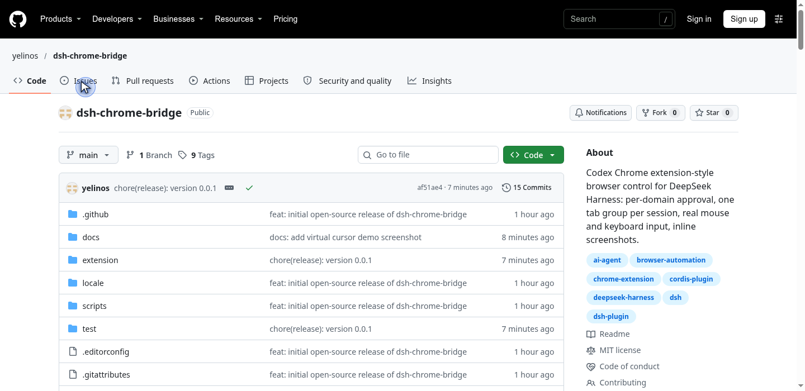

# DSH Chrome Bridge

[English](README.en.md) | 中文

[](https://github.com/yelinos/dsh-chrome-bridge/actions/workflows/ci.yml)
[](LICENSE)
[](extension/manifest.json)
[](https://github.com/topics/dsh-plugin)

让 DeepSeek Harness（DSH）的 Agent 操作你**真实、已登录的 Chromium 浏览器**。
思路对齐 OpenAI Codex 的 Chrome 扩展：浏览器里装一个小扩展作为桥，Agent 通过它在
专用标签组里开页、读页、点击、输入、截图；第一次接触某个域名时先征求你的批准。

- **零依赖扩展**：Manifest V3，只用 `chrome.*` API，不打包第三方运行时。
- **纯插件挂载**：无构建步骤，Host 半身是普通 ESM。
- **本机闭环**：扩展只主动连 `ws://127.0.0.1`，不监听端口、不暴露给网页。



## 功能特性

| 能力 | 说明 |
|---|---|
| 真实浏览器操作 | 打开/导航标签页、读页面文本、执行 JS、截图 |
| 真实鼠标键盘 | 选择器或坐标点击（支持双击/右键）、文本输入、按键与组合键（CDP `Input` 域） |
| 按域名授权 | 首次接触域名弹出「本次会话允许 / 始终允许 / 拒绝」；始终允许经 settings 服务持久化 |
| 会话级标签组 | 每个 Agent 会话独立 `DSH · <会话标识>` 标签组，多会话并行互不干扰 |
| 标签页自动回收 | 默认**复用当前会话标签页**；每会话最多保留 `maxSessionTabs` 个，超出按 LRU 自动关闭；空闲超时与会话结束时自动清理 |
| 标签组配色与命名 | 每个会话按哈希分配固定颜色；组名默认取首个页面标题，Agent 可用 `chrome_group` 改为简短目的名 |
| AX 快照 | `chrome_snapshot` 返回带层级、可见状态和稳定 `e1` 引用的无障碍树；默认输出增量 diff，`tab.ax.write()` 自动把状态/截图回传模型 |
| 批量动作（省往返） | `chrome_act` 一次工具调用按顺序执行多个动作并回传每次观察；`chrome_js` 提供持久 Codex 风格浏览器会话 |
| 虚拟光标 | 使用官方 `cursor-chat.png` 资源，隔离于页面样式；读页时显示，当前回合结束时收起 |
| 滚动页面 | `chrome_scroll` 按目标框或视口尺寸翻页，支持四个方向；像素滚动使用 Chrome 原生手势 |
| 截图直回对话 | PNG 经附件管线作为图像内容块直接给模型；无附件服务时回退为工作区文件 |
| 侧栏面板 | 右侧栏「+」菜单 → Chrome 桥接：连接状态、安装引导、域名名单 |
| 安全边界 | `blockedDomains` 永远拒绝；只能关闭 Agent 标签组内的页 |

## 架构

```
DSH Host 进程                         你的 Chrome / Edge
┌──────────────────────────┐          ┌────────────────────────────┐
│ chrome-bridge (service)  │  WS JSON │ DSH Chrome Bridge (MV3)    │
│  · WebSocket 服务器       │◄─────────┤  · service worker          │
│  · 命令/超时/keepalive    │ 127.0.0.1 │  · chrome.tabs/tabGroups  │
│  · status() Remote 接口   │ :8765    │  · chrome.debugger (CDP)   │
│ chrome-bridge-tools      │          │  · popup：状态/端口/token  │
│  · chrome_* 工具          │          └────────────────────────────┘
│  · 按域名授权 / 会话标签组 │
│  · 截图 → 附件管线        │          DSH Web UI
│ client.js                │          ┌────────────────────────────┐
│  · 侧栏状态卡/安装引导     │          │ 右侧栏「Chrome 桥接」面板   │
└──────────────────────────┘          └────────────────────────────┘
```

## 安装

### 1. 安装 DSH 插件

在 DSH 会话里让 Agent 执行 `plugin_manager` 的 `install_bundle`，目标为本目录的绝对路径；
或在终端：

```bash
dsh plugin --profile web add /absolute/path/to/dsh-chrome-bridge
```

这会挂载两个 Host 级行：

- `chrome-bridge`：桥接服务（WebSocket 服务器）
- `chrome-bridge-tools`：`chrome_*` 工具

**装好后刷新一次 Web 页面**，右侧栏「+」菜单里才会出现「Chrome 桥接」标签页。

### 2. 安装 Chrome / Edge 扩展

1. 打开 `chrome://extensions`（Edge 为 `edge://extensions`），开启「开发者模式」。
2. 点「加载已解压的扩展程序」，选择本包的 `extension/` 目录
   （侧栏面板里可一键复制该路径）。
3. 点扩展图标，确认显示 **Connected to DSH**（端口默认 `8765`，需与服务端一致）。

### 3. 验证

让 Agent 调用 `chrome_status`，应看到：

```
DSH Chrome Bridge connected:
- listening: true
- endpoint: ws://127.0.0.1:8765
- extension: DSH Chrome Bridge 0.1.1
- extension directory: /path/to/dsh-chrome-bridge/extension/
```

0.1.1 需要在扩展管理页重新加载，并重新挂载 DSH 插件。扩展增加了 HTTP/HTTPS 网站访问权限，用于隔离光标脚本及已有标签页注入。能力台账与验收状态见 `docs/parity/EXECUTION_STATUS.md`。

## 工具

| 工具 | 说明 |
|---|---|
| `chrome_status` | 桥接状态、扩展信息、扩展目录、域名名单、已连接浏览器列表 |
| `chrome_browser_diagnostics` | 扫描已安装 Chromium 浏览器/profile、运行状态、native host，并可按批准启动浏览器 |
| `chrome_use_browser` | 切换后续命令使用的已连接浏览器/profile |
| `chrome_tabs` | 列出标签页（默认仅 Agent 的 DSH 标签组，`all: true` 列全部） |
| `chrome_active_tab` | 返回当前活动/选中标签页 |
| `chrome_navigate` | 导航页面：**默认复用本会话当前标签页**，`newTab: true` 才新开；域名门禁 |
| `chrome_read_page` | 读页面 URL/标题/可见文本（截断） |
| `chrome_read_urls` | 在临时后台标签中批量读取多个 URL 的文本/HTML |
| `chrome_eval` | 在页面里执行 JS 并返回 JSON 值 |
| `chrome_click` | 真实鼠标点击：CSS 选择器或 x/y 坐标、双击、右键 |
| `chrome_type` | 真实键盘输入：可先按选择器聚焦，支持清空 |
| `chrome_key` | 按键：Enter/Tab/Escape/方向键等，支持 control/alt/shift/meta |
| `chrome_screenshot` | 截图作为附件图像直接返回（不可用时落盘），支持 PNG/JPEG、全页、裁剪 |
| `chrome_element_info` / `chrome_element_screenshot` | 从截图坐标识别元素/selector 候选，或裁剪元素截图 |
| `chrome_group` | 给本会话标签组起简短目的名（≤24 字符）并改颜色 |
| `chrome_snapshot` | 返回带层级、可见状态和稳定 ref 的 AX 树；默认增量 diff |
| `chrome_act` | 一次调用批量执行多个动作，减少往返 |
| `chrome_scroll` | 按 ref/坐标和 direction/pages 翻页，或用 deltaX/deltaY 滚动指定像素 |
| `chrome_move` | 移动虚拟光标到元素/坐标（不点击） |
| `chrome_open_tabs` / `chrome_claim_tab` / `chrome_release_tab` | 列出并接管/释放用户已有标签页 |
| `chrome_mark_tab` | 标记 deliverable / handoff 标签页，避免被自动清理 |
| `chrome_find` | 按 CSS/role/name/text/label/placeholder/testId 查找元素并返回 l-ref |
| `chrome_locator` | Playwright 风格定位器：count/click/fill/type/press/select/check/getAttribute/waitFor |
| `chrome_set_value` / `chrome_select_option` | 按 ref 设置表单值/选择原生 select 选项 |
| `chrome_upload` / `chrome_download` | 文件上传（file input 或 file chooser）与下载/下载列表 |
| `chrome_clipboard` / `chrome_dialog` | 读写页面剪贴板、检查/处理 JS 对话框 |
| `chrome_logs` | 读取 tab 的控制台/浏览器日志 |
| `chrome_page_assets` / `chrome_export` | 页面图片/样式/脚本/视频清单与打包，导出 text/html/pdf |
| `chrome_export_gsuite` / `chrome_export_youtube_transcript` | GSuite 文档导出、YouTube 字幕导出 |
| `chrome_management` / `chrome_history` / `chrome_bookmarks` | 标签组/窗口/历史/书签等浏览器组织 API |
| `chrome_viewport` / `chrome_visibility` / `chrome_cdp` / `chrome_network` | 视口覆盖、浏览器显示/最小化、原始 CDP、网络请求头/URL 阻断 |
| `chrome_user_takeover` | 暂停自动化并请用户接管登录/CAPTCHA/2FA |
| `chrome_js` | 持久 JavaScript 浏览器会话，暴露 `agent.browsers` / `browser.tabs` / `tab.playwright` / `tab.ax` / `tab.cua` / `tab.dom_cua` / `tab.clipboard` / `tab.dev` / `tab.content` / `tab.capabilities` |
| `chrome_webmcp` | 列出/调用页面定义的 WebMCP 工具 |
| `chrome_browser_auth` / `chrome_siwc` / `chrome_bot_detection` | 安全登录交接、Sign in with ChatGPT 检测、反自动化拦截上报 |
| `chrome_browser_info` / `chrome_notify` / `chrome_context_menu` / `chrome_side_panel` | 浏览器诊断、通知、右键菜单、扩展侧栏 |
| `chrome_favicon` / `chrome_tab_mentions` / `chrome_turn_ended` / `chrome_audit_trail` | 控制状态徽标、标签页 mentions、回合结束、变更审计 |
| `chrome_close_tab` | 关闭 Agent 标签组内的标签页（不碰用户自己的页） |

## 配置

`chrome-bridge`（服务行）：

| 字段 | 默认 | 说明 |
|---|---|---|
| `host` | `127.0.0.1` | 绑定地址 |
| `port` | `8765` | 端口 |
| `authToken` | `""` | 非空时扩展 popup 里需填相同 token |
| `commandTimeoutMs` | `20000` | 单条命令超时 |

`chrome-bridge-tools`（工具行）：

| 字段 | 默认 | 说明 |
|---|---|---|
| `tabGroupTitle` | `DSH` | Agent 标签组标题前缀 |
| `askForNewDomains` | `true` | 遇到新域名先问用户 |
| `allowedDomains` | `[]` | 始终允许的域名；volatile，可被「始终允许」写入并持久化 |
| `blockedDomains` | `[]` | 拒绝的域名 |
| `maxSnapshotChars` | `24000` | 页面文本截断长度 |
| `maxSessionTabs` | `3` | 每会话最多保留的 Agent 标签页；超出时关闭最久未用的 |
| `autoCloseIdleMs` | `180000` | 标签页空闲多久后自动关闭（0 关闭空闲清理） |
| `autoCloseOnSessionEnd` | `true` | Agent 会话结束时关闭其打开的所有标签页 |

修改方式：编辑 profile 的 `cordis.patch.yml`，按 id 覆盖对应行的 `config`；
或直接在对话里选择「始终允许」，由 settings 服务写入 `allowedDomains`。

## 安全模型

- 扩展只出不进：仅主动连 `ws://127.0.0.1:<port>`，不监听端口，网页无法访问它。
- 服务默认仅绑定回环地址；同机任意进程仍可连该端口，介意者请设置 `authToken`。
- `chrome.debugger` 附加时浏览器会显示「正在调试此浏览器」提示条，这是读写页面所必需的。
- 域名门禁在导航与页面交互（读/执行/点击/输入/截图）前执行；`blockedDomains` 永远拒绝。
- Agent 只能关闭 Agent 标签组内的标签页。
- 完整报告方式见 [SECURITY.md](SECURITY.md)。

## 开发与测试

```bash
npm run check      # 语法 / JSON / manifest / 版本一致性
npm run parity:ledger   # 重新生成官方能力台账
npm run parity:baseline # 留档 Git/版本/指纹基线
npm run test:unit  # 协议层、工具层、Service 生命周期、Client 注册
npm run test:e2e   # 真实 Chrome for Testing 端到端（需 .tools/chrome-linux64/chrome）
```

单元测试会从 DSH 安装目录解析 `@deepseek-ai/*` 包；不在 DSH 环境时请先让
`node_modules` 指向 DSH 安装（例如符号链接）。

开发约定与提交流程见 [CONTRIBUTING.md](CONTRIBUTING.md)。

## 已知限制

- 依赖浏览器扩展与 `chrome.debugger`，仅支持 Chromium 系（Chrome/Edge/Chromium）。
- 标签组按会话拆分；同一会话内所有标签共用一个组。
- 若附件服务不可用（精简组合），截图回退为工作区文件 + `read_image`。
- 实验性插件；协议为包内私有 v1，可能随版本调整。

## 许可证

[MIT](LICENSE) © 2026 yelinos

第三方依赖声明见 [THIRD_PARTY_NOTICES.md](THIRD_PARTY_NOTICES.md)。
